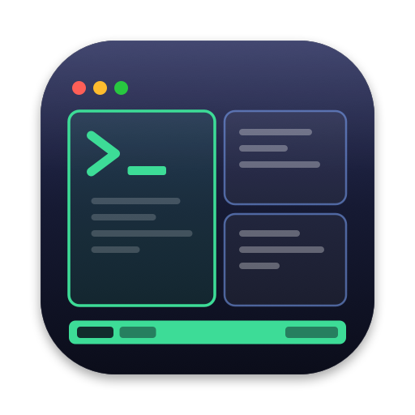
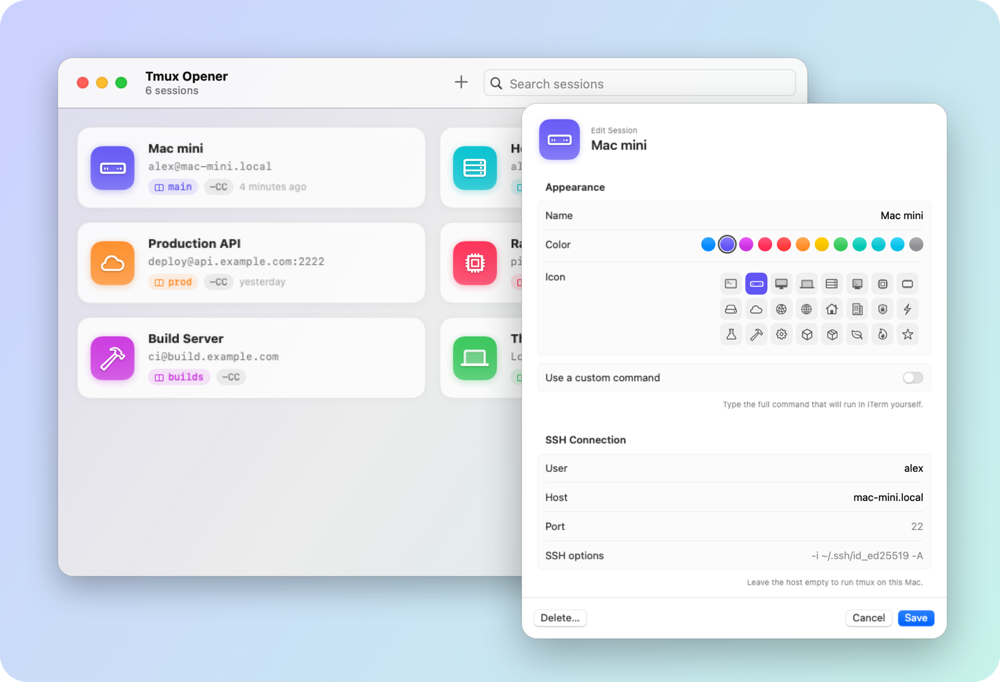
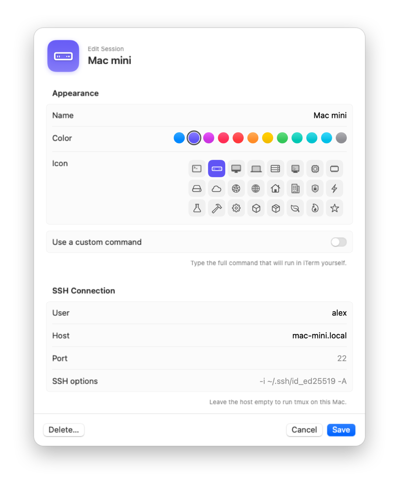
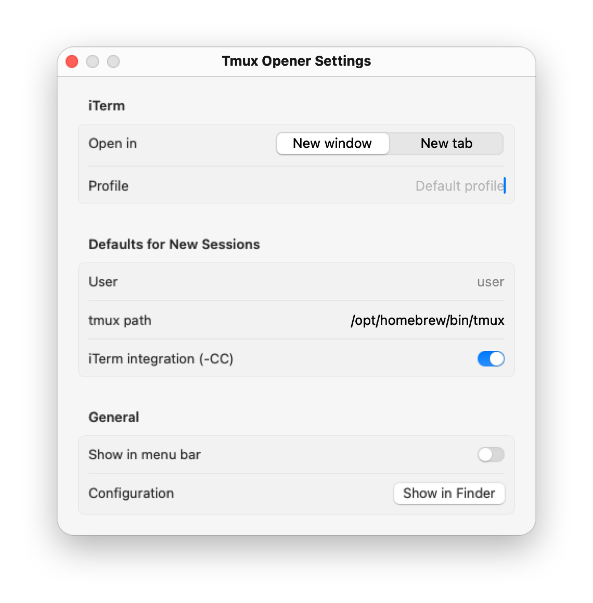

<div align="center">



# Tmux Opener

**Your tmux sessions, one click away.**

A tiny, native macOS app that keeps a list of your tmux sessions — local or over SSH —
and opens any of them in iTerm with a single click.

[](https://github.com/SecureCMD/tmux-opener/actions/workflows/build.yml)
[](https://github.com/SecureCMD/tmux-opener/releases/latest)
[](#requirements)
[](Sources/TmuxOpener)
[](LICENSE)

[**Download**](https://github.com/SecureCMD/tmux-opener/releases/latest) ·
[Features](#features) ·
[Install](#install) ·
[Usage](#usage) ·
[Configuration](#configuration) ·
[Build from source](#build-from-source)

<br>

<picture>
  <source media="(prefers-color-scheme: dark)" srcset="docs/images/hero-dark.png">
  
</picture>

</div>

## Why?

If you live in tmux across a few machines, you probably have a handful of commands like this
one somewhere in your shell history:

```sh
ssh -t alex@mac-mini.local '/opt/homebrew/bin/tmux -CC new -A -s main'
```

Tmux Opener turns each of them into a card. Click it and iTerm opens a new window (or tab),
connects, and attaches to the session — creating it if it doesn't exist yet. With iTerm's
[tmux integration](https://iterm2.com/documentation-tmux-integration.html) (`-CC`), your
remote tmux windows show up as native iTerm tabs.

## Features

- **One click to attach** — runs `ssh -t user@host 'tmux -CC new -A -s <session>'` in iTerm.
- **Local sessions too** — leave the host empty to run tmux on this Mac.
- **Fully configurable** — user, host, port, extra `ssh` flags, tmux path, session name,
  `-CC` on or off, or a completely custom command.
- **Live command preview** — see exactly what will run before you save.
- **Nice to look at** — colors and SF Symbols per session, light and dark mode.
- **Menu bar extra** — launch any session without opening the main window.
- **Keyboard friendly** — <kbd>⌘</kbd><kbd>1</kbd>…<kbd>⌘</kbd><kbd>9</kbd> launch the first
  nine sessions, <kbd>⌘</kbd><kbd>N</kbd> creates a new one.
- **Search & reorder** — filter as you type, drag cards to rearrange them.
- **Plain JSON config** — easy to back up, sync or share; import/export built in.
- **Tiny and native** — pure SwiftUI, no dependencies. English and Spanish.

<table>
  <tr>
    <th width="50%">Session editor</th>
    <th width="50%">Settings</th>
  </tr>
  <tr>
    <td>
      <picture>
        <source media="(prefers-color-scheme: dark)" srcset="docs/images/editor-dark.png">
        
      </picture>
    </td>
    <td>
      <picture>
        <source media="(prefers-color-scheme: dark)" srcset="docs/images/settings-dark.png">
        
      </picture>
    </td>
  </tr>
</table>

## Requirements

- macOS 14 Sonoma or later (Apple Silicon or Intel)
- [iTerm2](https://iterm2.com)
- `tmux` on the machines you connect to (`brew install tmux` on a Mac)

## Install

### Homebrew

```sh
brew tap securecmd/tmux-opener https://github.com/SecureCMD/tmux-opener
brew install --cask tmux-opener
```

Upgrade with `brew upgrade --cask tmux-opener`. To remove the app and its settings,
run `brew uninstall --zap --cask tmux-opener`.

### Download

1. Grab `TmuxOpener-<version>.zip` from the
   [latest release](https://github.com/SecureCMD/tmux-opener/releases/latest).
2. Unzip it and drag **Tmux Opener.app** to `/Applications`.
3. Open it.

> [!NOTE]
> The app is open source and ad-hoc signed, not notarized by Apple. Homebrew takes care of this
> for you; with a manual download, the first time you open it
> macOS will say it can't verify the developer. Go to **System Settings → Privacy & Security**
> and click **Open Anyway**, or run:
>
> ```sh
> xattr -dr com.apple.quarantine "/Applications/Tmux Opener.app"
> ```

### Build from source

```sh
git clone https://github.com/SecureCMD/tmux-opener.git
cd tmux-opener
make install   # builds and copies "Tmux Opener.app" to /Applications
```

Only the Xcode Command Line Tools are needed (`xcode-select --install`). See
[Build from source](#build-from-source) for details.

## Usage

1. Click **+** (or press <kbd>⌘</kbd><kbd>N</kbd>) and fill in the host, user and session name.
2. Click the card. iTerm opens and attaches to the session.

The first time you launch a session, macOS asks whether Tmux Opener may control iTerm.
Click **OK**. If you denied it by accident, re-enable it in
**System Settings → Privacy & Security → Automation → Tmux Opener → iTerm**.

### What gets run

| Session settings | Command typed into iTerm |
| --- | --- |
| user `alex`, host `mac-mini.local`, session `main` | `ssh -t alex@mac-mini.local 'tmux -CC new -A -s main'` |
| …plus port `2222` and SSH options `-A` | `ssh -t -p 2222 -A alex@mac-mini.local 'tmux -CC new -A -s main'` |
| no host, session `scratch` | `tmux -CC new -A -s scratch` |
| `-CC` turned off | `ssh -t alex@mac-mini.local 'tmux new -A -s main'` |
| custom command | exactly what you typed |

`new -A -s <name>` attaches to the session if it exists and creates it otherwise. The command
is typed into a regular login shell, so your `~/.ssh/config`, agent and aliases all apply, and
you drop back to the shell when you detach.

> [!TIP]
> If tmux isn't on the remote `PATH` for non-interactive shells (common with Homebrew),
> set **tmux path** to the full path, e.g. `/opt/homebrew/bin/tmux` or `/usr/local/bin/tmux`.

### Shortcuts

| Shortcut | Action |
| --- | --- |
| <kbd>⌘</kbd><kbd>N</kbd> | New session |
| <kbd>⌘</kbd><kbd>1</kbd> … <kbd>⌘</kbd><kbd>9</kbd> | Launch session 1–9 |
| <kbd>⌘</kbd><kbd>,</kbd> | Settings |
| Right-click a card | Connect, edit, duplicate, copy command, delete |
| Drag a card | Reorder |

## Configuration

**Settings** (<kbd>⌘</kbd><kbd>,</kbd>):

- **Open in** — new iTerm window or new tab in the current window.
- **Profile** — iTerm profile to use (empty means the default profile).
- **Defaults for new sessions** — user, tmux path and `-CC`.
- **Show in menu bar** — toggle the menu bar extra.

Sessions are stored as JSON in:

```
~/Library/Application Support/TmuxOpener/sessions.json
```

```json
[
  {
    "name": "Mac mini",
    "user": "alex",
    "host": "mac-mini.local",
    "port": 22,
    "sshOptions": "-A",
    "sessionName": "main",
    "tmuxPath": "/opt/homebrew/bin/tmux",
    "controlMode": true,
    "useCustomCommand": false,
    "customCommand": "",
    "colorName": "indigo",
    "symbol": "macmini"
  }
]
```

Every field is optional; missing ones fall back to their defaults. Use
**File → Export Sessions…** / **Import Sessions…** to move your list between Macs.
To keep the file somewhere else (e.g. a synced folder), launch the app with:

```sh
open "/Applications/Tmux Opener.app" --args -configDirectory ~/Dropbox/tmux-opener
```

## Build from source

```sh
make            # build/Tmux Opener.app
make run        # build and launch
make install    # build and copy to /Applications
make zip        # build/TmuxOpener-<version>.zip
make universal  # arm64 + x86_64 zip (needs full Xcode)
```

It is a plain Swift package, so you can also open `Package.swift` in Xcode. `scripts/build.sh`
compiles it, wraps the binary in an `.app` bundle, draws the icon
(`scripts/make_icon.swift`) and signs it ad hoc.

```
Sources/TmuxOpener/
├── TmuxOpenerApp.swift    App, menus and menu bar extra
├── ContentView.swift      Main window and session cards
├── SessionEditor.swift    Add/edit sheet
├── SettingsView.swift     Settings window
├── SessionStore.swift     Persistence, import/export, launching
├── ITermLauncher.swift    AppleScript bridge to iTerm
├── Models.swift           Session model and command builder
└── Screenshots.swift      Staged captures for this README
Resources/                 Info.plist and localizations (en, es)
scripts/                   Build, icon and screenshot scripts
Casks/tmux-opener.rb       Homebrew cask (this repo doubles as a tap)
```

To regenerate the screenshots in `docs/images` with demo data, run `scripts/screenshots.sh`.

Releases are automated: pushing a tag like `v1.2.0` builds a universal binary on GitHub Actions,
attaches the zip to a new GitHub release and bumps the Homebrew cask in
[`Casks/tmux-opener.rb`](Casks/tmux-opener.rb).

## Contributing

Bug reports, ideas and pull requests are welcome. See [CONTRIBUTING.md](CONTRIBUTING.md).

## License

[MIT](LICENSE) © SecureCMD
